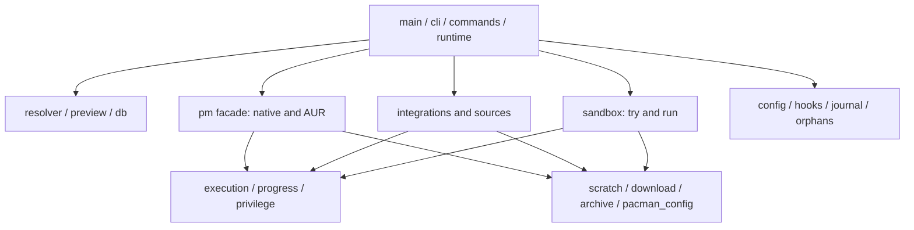

# Architecture and maintenance map

This map describes ownership and change impact. Read the relevant rows, then
trace actual callers with `rg`: shared data, globals, environment variables and
resource lifetimes create relationships that imports alone do not show.

## Current organization

pacpin is one Rust binary crate. Related implementation files already live under
`commands/`, `pm/`, `sources/` and `integrations/`. Each boundary should expose
operations its callers need and keep implementation details private.

Development instructions follow the same approach: AGENTS.md contains the core
rules and mandatory reading index; detailed manager, execution, UI, security,
verification and VM contracts live under `docs/development/`. Existing detailed
instructions are preserved there. Read the documents required for the affected
area instead of treating the index as a replacement for its contracts.



This is an ownership overview, not a strict dependency graph. Shared process
tracking and bounded metadata capture now live in the neutral `execution`
owner, which imports neither `sandbox` nor `progress`. Progress registers a
terminal-restore callback during session startup. Shared executable-path policy
lives in `utils`, used by archive, database and sandbox inventory. Legacy
exceptions below remain explicit migration targets.

### Invocation, execution and ephemeral applications

| Owner | Responsibility |
| --- | --- |
| `main.rs` | Module declarations, compatibility exports and entry into `cli::run` (about 55 lines) |
| `cli/{mod,help,tests}.rs` | Invocation startup and dispatch, CLI reference and preserved CLI regression checks |
| `wizard.rs`, `wizard/{preferences,prompts,review,tests}.rs` | Interactive setup coordination, validated line input, preservation-aware preferences, effective settings review and current feature guidance; no package-manager execution |
| `config/setup.rs` | Bounded exact snapshots of all four config files; locked conflict detection, private main-config backups and the existing atomic config writer; supplemental files stay user-owned |
| `commands/pins.rs` | Pin matching and smart unpin, including persistence and approval |
| `execution/mod.rs` | Tracked children/groups, owned cleanup registry, graceful cancellation and child guards |
| `execution/resources.rs` | Instance-owned cleanup registry; production has one invocation registry, tests use independent instances |
| `execution/capture.rs` | Bounded concurrent output capture, optional stream observation, timeout and descendant cleanup; no UI policy |
| `execution/tests.rs` | Preserved cancellation, resource-registry and bounded-capture checks |
| `sandbox.rs` | Native/provider app routing and TryOptions facade (about 135 lines) |
| `sandbox/native.rs` | Native app archive preparation, aggregate downloads and launch |
| `sandbox/providers.rs` | Backend-specific Flatpak/Nix/Pipx ephemeral operations |
| `sandbox/mounts.rs` | Bubblewrap probes and permitted host mounts |
| `sandbox/workspace.rs` | App resource guard, private directories and conservative stale cleanup |
| `sandbox/entrypoints.rs` | Selection within the requested package's executable inventory |
| `progress.rs` | Session/footer and foreground/background display transport; background downloads use a separate process group while retaining the invoking terminal session |
| `progress/observer.rs` | Bounded byte/escape normalization and operation markers |
| `progress/stages.rs` | Scoped concurrent checks and pending approved manager stages; checking never marks an upgrade complete |
| `progress/overview.rs` | Phase tabs derived from actual pending/completed/failed/skipped manager state; completed update tick, current cleanup detail policy and narrow-tab overflow |
| `progress/metrics.rs` | Aggregate progress estimates and concise phase labels |
| `progress/transfers.rs` | Manager-specific transfer interpretation, scoped percentages and typed preparation windows shared by installs/upgrades |
| `integrations/preparation.rs` | Approved optional preparation jobs, explicit capability policy, phase gating and join/abort lifetime |
| `commands/upgrade/execution_plan.rs` | Remaining staged work for approval/dry-run: typed provider command/internal actions, shared core command previews, conditional orphan/hooks/cache/restart lifecycle; never an executable transaction script |
| `progress/tests.rs` | Preserved renderer, parser, terminal and child-transport checks |

Command capture no longer lives in the terminal renderer. HTTP, archive,
privilege, scratch and AUR workspace callers use `execution` for shared lifetime
operations; app-specific stale cleanup remains with sandbox. Metrics do not
establish process success. See [design rationale and references](development/design.md).

### Native and AUR boundary

`db::find_sync_package` owns native repository target lookup for transaction
previews, native try/run archives (including missing dependencies), install
routing, and candidate conflict/delay checks. It delegates exact-name-before-provider
selection and version matching to ALPM, retaining explicit repository scope.
Installed inventory and the resolver's pin/vendor/exclusion policy intentionally
use exact identities; those policy decisions must not substitute a virtual provider.
The preview owns transaction preparation and detailed ALPM errors, including
version-aware replacement removals; it never commits packages.

`src/pm.rs` is the public facade. Callers continue to use `pm::install`,
`pm::clean_scoped`, `pm::check_lock` and other existing APIs.

| File | Responsibility |
| --- | --- |
| `pm.rs` | Public exports, refresh, download authorization, dependency reasons, and the remaining removal/query/forwarding entry points |
| `pm/install.rs` | Install options, command preview and approved native/AUR/Sources installation |
| `pm/pinning.rs` | Native/AUR pin intent from original qualified requests and selected companions; helper routing/discovery cannot add pins; successful targets gate persistence |
| `pm/cache.rs` | Cache scopes, answers, cleanup outcomes and guarded stale download-directory removal |
| `pm/lock.rs` | Inspect the native database lock and wait for it |
| `pm/validation.rs` | Repository-aware package conflicts and stability-delay checks |
| `pm/continuation.rs` | AUR helper execution and positive evidence required for independent continuation |
| `pm/workspace.rs` | Private AUR workspace and supported helper scratch configuration |
| `pm/rebuild.rs` | AUR rebuild validation and installed-result verification |
| `pm/orphans.rs` | Execute exactly the approved orphan-removal set |
| `pm/tests.rs` | Shared native fixtures and facade contract checks; cache-specific tests stay in `cache.rs` |

The first split reduces `pm.rs` from 2,123 to roughly 240 lines. Installation
remains a substantial module because it contains a long orchestration function;
its next split should introduce explicit planning/execution results rather than
just cutting that function into helpers sharing a large mutable context.

### Upgrade planning and future additions

`commands/upgrade.rs` keeps transaction ordering and its public command API.
Its private `commands/upgrade/preflight.rs` owns one typed capability/eligibility
result: failed manager discovery and unsupported options may skip their manager
with --keep-going; invalid
plans remain fatal. It projects discovered inventory before counts, hook planning,
approval, downloads and execution. Required provider capability methods prevent
an adapter from silently inheriting support. Core AUR and external stages are
separate typed identities, even when an external display name is AUR.

`discovery.rs` owns lossless typed per-manager metadata reports and manager/phase
failure identities, including exact `Source(alias/package)` failures. Provider
check methods themselves must return lossless reports, so a Sources adapter can
retain successful siblings instead of collapsing partial discovery to an error.
Integration discovery pipelines each manager's own refresh/check independently;
there is no global metadata-refresh barrier. Sources start before native refresh;
native/AUR resolution still requires refreshed native metadata. Collectors return these reports;
the resolver records AUR failures with the same identity. Strict `check` consumes
complete reports explicitly. Upgrade supplies failures to eligibility, including
refresh failures (which prohibit rechecking stale metadata). The single plan
excludes failed managers from targets, prefetch, actions and cleanup; retains
unknown counts and typed reasons in skipped footer rows; preserves pending orphan
cleanup and drives a nonzero
incomplete result. Native initialization/refresh/transaction failures remain
fatal and cannot be represented as a skippable native discovery manager.
Hook planning consumes the same AUR eligibility decision to block AUR rebuilds;
scripts watching verified successful changes retain their independent conditions.

`commands/upgrade/planning.rs` owns requested-target classification,
ignores, delay policy and conversion into result records.
`IntegrationProvider::upgrade_actions` requires each backend to return typed
`UpgradeAction::Command` or `Internal` actions, with errors for invalid approved
plans. Configured adapters use their actual argument expansion; Sources describe
the retained approved recipe without a second lookup or recursive pacpin call.
`commands/upgrade/execution_plan.rs` presents these actions and preparation
policies alongside core previews from `pm::build_install_commands`. Actual
executed descriptions remain suitable for history, without inventing an overall
shell script for internal/conditional actions.
Routine approval renders short unnumbered labels; dry runs retain action and
preparation details. `pm/cache_usage.rs` owns bounded read-only cache estimates;
the UI displays these separately from installed-package space change.
`progress/overview.rs` renders a horizontal phase strip in the existing separator
row, while manager metrics retain their own rows. Upgrade finalization owns
pending orphan/cache lifetimes and preserves cache cleanup after partial failure.
`commands/upgrade/tests.rs` preserves the command/planning regression checks.
The main file drops from 1,835 to roughly 1,130 lines; its remaining long command
function is a further refactoring target, not a small facade yet.

Use this existing structure when adding features:

```text
src/
  main.rs                     # thin crate entry
  cli/                        # invocation routing and help
  wizard.rs                   # setup coordination and command validation
  wizard/                     # preferences, line input, review and tests
  config/setup.rs             # exact setup snapshots, backups and locked save
  execution/                  # neutral child/resource/capture ownership
  sandbox/                    # native/provider apps, mounts, inventory, workspace
  progress/                   # output normalization, metrics, scoped stage state and tests
  commands/                   # user-command orchestration
    upgrade.rs                # public upgrade/install entry points
    upgrade/
      planning.rs             # requested target planning
      preflight.rs            # required capability checks and eligible projection
      tests.rs                # command and planning contracts
    ephemeral.rs              # try/run CLI controls
    ...                       # other command owners
  pm.rs                       # stable native/AUR boundary
  pm/
    install.rs
    pinning.rs                # explicit repository intent and successful-target confirmation
    cache.rs
    lock.rs
    validation.rs
    continuation.rs
    workspace.rs
    rebuild.rs
    orphans.rs
    tests.rs
  integrations.rs             # provider contract and coordination
  integrations/
    builtin.rs
    configured.rs
  sources/
    mod.rs                    # recipe/plan API
    catalog.rs
    direct.rs
    provider.rs
    discovery.rs              # rolling bounded per-package checks and lossless outcomes
    install.rs
    build.rs                  # compilation, output inspection and capacity
    build/recipe.rs           # trusted TOML build schema and approval preview
    build/profile.rs          # temporary makepkg settings and tracked invocation
    build/tests.rs            # inherited defaults and opt-in validation
    git.rs                    # exact release-tag resolution and approved fetch
  ...                         # cohesive shared owners listed in the map
```

A future manager implementation belongs under `integrations/`; a new source
discovery model belongs under `sources/`; a command belongs under `commands/`.
Shared execution/storage code needs one neutral owner, not copies in each
manager's folder. Rust supports both `owner.rs` + `owner/child.rs` and
`owner/mod.rs` + `owner/child.rs`: retain each existing convention unless changing
it has a concrete benefit. Add folders when they contain implementations; do not
pre-create empty scaffolding or make callers import private child paths.

## Change-impact checklist

Download preparation crosses `commands/upgrade` → `integrations/preparation`
→ provider adapters → `download` or `execution/capture`. Foreground
`progress::run_observed` emits typed windows interpreted by the same transfer
parser that supplies footer labels. Each provider must declare Background,
BeforeStage or Unsupported. Only private verified release artifacts currently
use Background; backend caches lack a cross-manager space reservation and stay
BeforeStage. Preparation never verifies an installed upgrade. Failed preparation
allows the ordinary stage to retry; stopped plans join started jobs without
starting queued work. Jobs and footer rows use the eligible approved inventory.
See the preparation scenarios in the verification contract. Helpers can fetch
more inputs after a first build phase; overlap is opportunistic, not exclusive
bandwidth scheduling for every AUR package.

Review the owner and related modules in both directions: a caller may supply a
new option while a downstream consumer interprets a changed result. Choose
verification from the changed contract, not only the filename.

| Change | Owner and related code to inspect | Contracts and verification |
| --- | --- | --- |
| CLI flags, scope or privilege override | `cli`, `commands/cli`, `runtime`, `commands/{upgrade,rebuild,ephemeral,maintenance}`, `manager_config`, `pm/install`, integration adapters | Option values and `--`; reject unsupported combinations before effects; no leaked pacpin flags; dry-run and scoped commands; runtime-flag VM verifier |
| Configuration schema or persistence | `config`, `config/setup`, `manager_config`, `wizard`, `commands/{pins,delays,rebuild}`, `sources`, `hooks`, configured integrations | Preserve legacy fields and supplemental files; validate duplicates; atomic writes and locks; read-only commands create nothing; config and manager checks; init VM fresh/reconfigure/reset/cancel/conflict scenarios |
| Install pin intent or VCS version policy | `pm/{install,pinning}`, `resolver`, `config`, `commands/{pins,check,upgrade}`, Sources ownership | Original qualified requests versus helper routing/discovery; preserve selected companions and existing exact/glob rules; gate persistence on success; stale AUR VCS metadata must not trigger downgrades; unit and actual VM install checks |
| Native resolution or transaction plan | `db`, `pacman_config`, `resolver`, `preview`, `commands/{check,upgrade,rebuild}`, `pm/{install,validation}`, `ui`, `journal`, `hooks` | Exact repositories/targets, provides/conflicts, solver dependencies, display counts, capacity estimates and approved/installed result identity; ALPM fixtures and native VM scenarios |
| AUR metadata, helper or continuation | `aur`, `resolver`, `commands/upgrade`, `pm/{install,continuation,workspace,rebuild,cache}`, `sources/install`, `hooks` | Build unprivileged; actual helper result; recognized build failure versus native damage; keep-going stays opt-in; failure remains visible; actual AUR + Sources VM scenarios |
| External manager capability or operation | `manager_config`, `integrations`, `integrations/{builtin,configured}`, `commands/{check,upgrade,rebuild}`, `sandbox`, `journal`, `ui` | Preserve scoped approved identities; declare unsupported flags; exact result verification; metadata failure is not no work; inspect upgrade, explicit actions, manifest and ephemeral paths separately; manager and real-manager verifiers |
| Source recipe, provider or packaging | `sources/{mod,catalog,direct,provider,install,build,git}`, `sources/build/{recipe,profile}`, `integrations`, `pm/{install,continuation}`, `commands/{upgrade,rebuild}`, `download`, `archive`, `scratch`, `progress`, `journal`, `hooks` | Discovery versus verification versus installation; exact approved Git commits, literal local build commands and opt-in optimization; prefetch ownership; dependencies and actual archive footprint; unprivileged makepkg; source-only, native + Sources, compile failure/cancellation and cleanup VM scenarios |
| Scratch, cache or storage policy | `scratch`, `runtime`, `preview`, `pm/{workspace,install,cache}`, `sources/install`, `sandbox`, `download`, `archive`, configured integrations | RAM reserve, bytes/inodes/quotas, forced-medium refusal, peak root capacity, owned cleanup and per-manager outcome; runtime, housekeeping, installed-run and storage-failure VM checks |
| Process execution, cancellation or authentication | `execution`, `progress`, `sandbox` app lifetimes, `privilege`, `pm`, sources and integrations, `hooks`, legacy callers listed below | Inherited input/controlling terminal, one sudo prompt per invocation, bounded capture, correct exit status, graceful cancellation, ALPM lock release, owned cleanup; real auth/interruption VM checks |
| Footer, output or selection | `progress`, `ui`, `tui_select`, `repo_menu`, `commands/{upgrade,orphans,ephemeral}`, `pm`, sources and integrations, `privilege`, `restart` | Real manager rows, aggregate metrics, prompts, no blank lines/stale suffixes, single Enter, resize/teardown, narrow terminals and redirected output; rendered-screen and scrollback VM checks |
| Orphan inventory or removal | `orphans`, `db`, `ui`, `commands/{upgrade,orphans}`, `pm/{orphans,validation}`, `journal`, `progress` | Inventory versus pending selection; re-offer after failure; retained optional/transitive dependencies; approved nonrecursive removal; interruption and next-invocation checks |
| Journal, hooks, restart inspection or rollback | `journal`, `hooks`, `restart`, `commands/{history,upgrade}`, `pm/{install,cache,rebuild}`, integrations | Record verified changes; hooks run once only after eligible success; cleanup before restart advice; rollback supports native history only; hook, partial-failure and narrow advisory checks |
| Ephemeral apps, executable ownership or sandbox mounts | `commands/ephemeral`, `sandbox`, `runtime`, `db`, `download`, `archive`, `scratch`, `progress` | Requested package owns the entry point; installed fallback stays explicit/scoped; normal run outputs persist; try private data disappears; eligible cwd mounts; actual RAM/storage/run/try fixtures |
| HTTP, archive or filesystem safety | `download`, `archive`, `sources/{catalog,direct,install}`, integration metadata/cache, `config`, `manager_config`, `scratch`, `sandbox` | Bounded bodies, credentials/redirects, regular-file hashing, atomic replacement, symlink confinement, actual entry counts and cleanup; security fixtures plus relevant consumer paths |

Example caller search:

```sh
rg -n 'pm::(install|clean_scoped|check_lock)|InstallOptions' src
rg -n 'register_child|run_tracked_command|capture_output|start_background' src
rg -n 'sources::|IntegrationProvider|ExternalUpdate' src
```

Also search the actual type/function being changed and persistent keys it reads
or writes. These examples are not an automatic architecture-enforcement tool.

## Remaining ownership exceptions

Do not infer that all interactions have been centralized from the folder names.
These are existing migration targets, not patterns to copy:

- `commands/upgrade.rs` still assembles the native background-prefetch command.
- `pm.rs` still uses direct child status handling for removal, search/info and
  forwarding; `cli/mod.rs` also has a final helper/native forwarding path.
- `commands/rebuild.rs` contains manifest-specific Flatpak discovery/install
  commands distinct from the upgrade adapter.
- `journal.rs` combines persistence with rollback execution and its own cache
  directory query; `commands/maintenance.rs` contains direct keep execution.
- `sandbox/providers.rs` contains Flatpak/Nix/Pipx ephemeral operations distinct from the
  upgrade adapter, with app-specific workspaces; shared process tracking now lives in execution.
- Source artifact HTTP/progress and native package download transport differ.
  Keep provider authentication and checksum policy explicit when extracting
  shared transport helpers.

These paths need operation-specific outcomes and ownership review before moving
them to a common executor. A blanket command wrapper would not establish correct
manager policy or guarantee lock release.

## Further division by responsibility

The pre-refactor review found large files: `commands/upgrade.rs` 1,835 lines,
`progress.rs` 1,717, `sandbox.rs` 1,669, `ui.rs` 1,403, and
`sources/install.rs` 1,003. Counts include comments and tests; compact integration
code can still be difficult to maintain despite a lower line count. Function
size, shared state and mixed ownership matter more than file length alone.

Use these staged targets when extending the corresponding feature:

| Area | Suggested internal division | Main condition before extraction |
| --- | --- | --- |
| Process infrastructure | Neutral execution owner is implemented; migrate remaining raw legacy calls to operation-specific APIs | Preserve terminal input, graceful interrupt, lock-release evidence and exact forwarding behavior |
| Upgrade command | Extend the existing `commands/upgrade/planning.rs` split with `execution.rs` and `finalize.rs`, then shrink the orchestrator | Separate approved plan from verified stage results; finalization must receive real per-manager outcomes, not infer success from a completed download |
| Installation | `pm/install/{planning,execution}.rs` once typed intermediate results are defined | Preserve delay checks, companion selection, source/native/AUR ordering, journal and cleanup outcomes |
| Progress | Metrics, observer and tests are split; terminal/relay separation remains a future target | Keep one owner for cursor/scroll region and authentication suspension; metric parsing must not control process success |
| Ephemeral applications | Native/provider/mount/entrypoint/workspace division is implemented; shared path classification is in utils | Preserve resource guards, app exit semantics and normal output persistence |
| Plan and selection UI | `ui/{format,plan,selection}.rs` | Pure width/format helpers stay independent; interactive input and selector lifetimes remain coordinated with the footer |
| Source installation | `sources/{workspace,artifact,packaging,install}.rs` | One owner for prefetched artifacts and cleanup; maintain provider-specific trust/credential policy and makepkg/pacman privilege separation |
| Built-in integrations | `integrations/builtin/{flatpak,nix,pipx}.rs` plus limited shared metadata helpers | Manager identity/verification stays with its own adapter; no common interface assumption about cache or scratch support |
| History | `journal` for bounded persistence; a dedicated rollback boundary for native restore operations | Preserve native-only rollback limits, approved archive/version identity and privilege/cancellation handling |

The pm, upgrade-planning/preflight, CLI, execution, sandbox and progress
metrics/observer divisions are implemented. Other entries are future targets. Do one
responsibility at a time, preserving the existing facade and behavior before
introducing new APIs. Avoid moving every root module into a new folder just for
visual symmetry or adding a workspace of crates without an independent API need.

For a new feature, write its owner, inputs, outcomes, resource lifetime and
affected callers before choosing a file. Prefer a small concrete struct/enum
where it makes invalid stage transitions harder; do not introduce a universal
package-manager abstraction that erases differences in capability or failure.

## User configuration

Keep the existing colocated files:

| File | User-owned responsibility |
| --- | --- |
| `config.toml` | Pins, manifests, preferences, repository order and delays |
| `managers.toml` | Manager definitions, explicit capabilities and custom flags/actions |
| `sources.toml` | Upstream release recipes |
| `hooks.toml` | Conditional post-upgrade commands/rebuilds |

Legacy inline sources/hooks remain supported. Internal module splitting does not
add user preferences and needs no fifth file. Add a separate file only if a new
user-owned concern has its own schema/lifecycle; update loading, validation,
initialization, persistence and documentation together.

## Verification and review evidence

Follow AGENTS.md for cargo test, strict all-target Clippy, release build, installed
binary equality and affected VM scenarios. Keep structural moves distinguishable
from behavior changes in the diff. Confirm all previous tests remain discovered
after moving test modules. Report any unavailable or unverified scenarios.

The first split and its 73 passing disposable-VM checks are recorded in
[the 2026-10-14 verification report](verification/2026-10-14-module-layout.md).

The subsequent capability preflight, neutral execution/app divisions and
per-manager footer state are documented in
[the capability and architecture verification report](verification/2026-10-14-capabilities-architecture.md).

Source compilation, cleanup and authentication checks are recorded in
[the source-build verification report](verification/2026-10-15-source-builds.md).
Explicit pin intent and stale VCS version handling are covered in
[the AUR pinning report](verification/2026-10-15-aur-pinning.md).
Background download process groups, orphan-menu input handoffs and the combined
terminal/manager audit are recorded in
[the orphan handoff report](verification/2026-10-15-orphan-handoff.md).

The map and instructions make reviews easier; they cannot alone prevent a
regression. Narrow APIs, explicit ownership and verification of real failure
paths provide the evidence that a change preserved its contracts.

The shared native lookup, versioned replacement/reinstall policy, concurrent
checks regression and focused CLI audit are recorded in
[the native lookup report](verification/2026-10-16-native-lookup.md).

Typed discovery outcomes, shared continuation eligibility, scoped hooks and
required footer skip causes are covered in
[the discovery continuation report](verification/2026-10-17-discovery-continuation.md).
